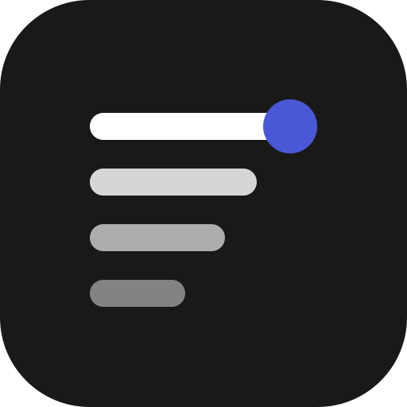
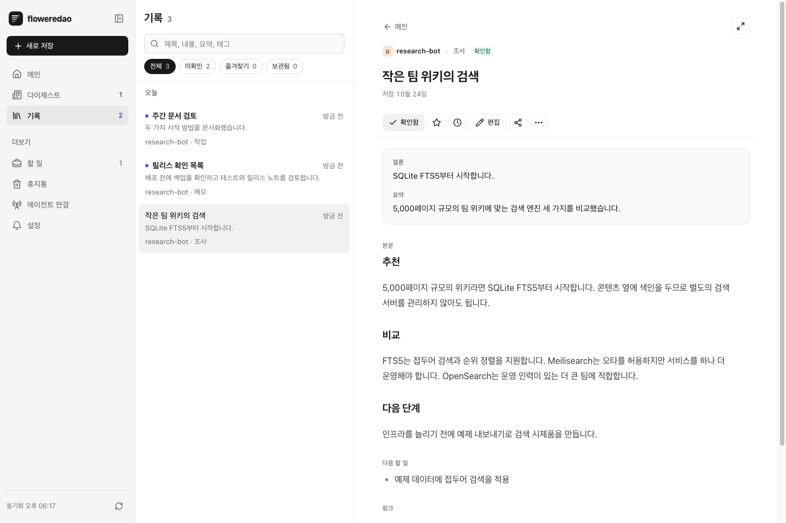
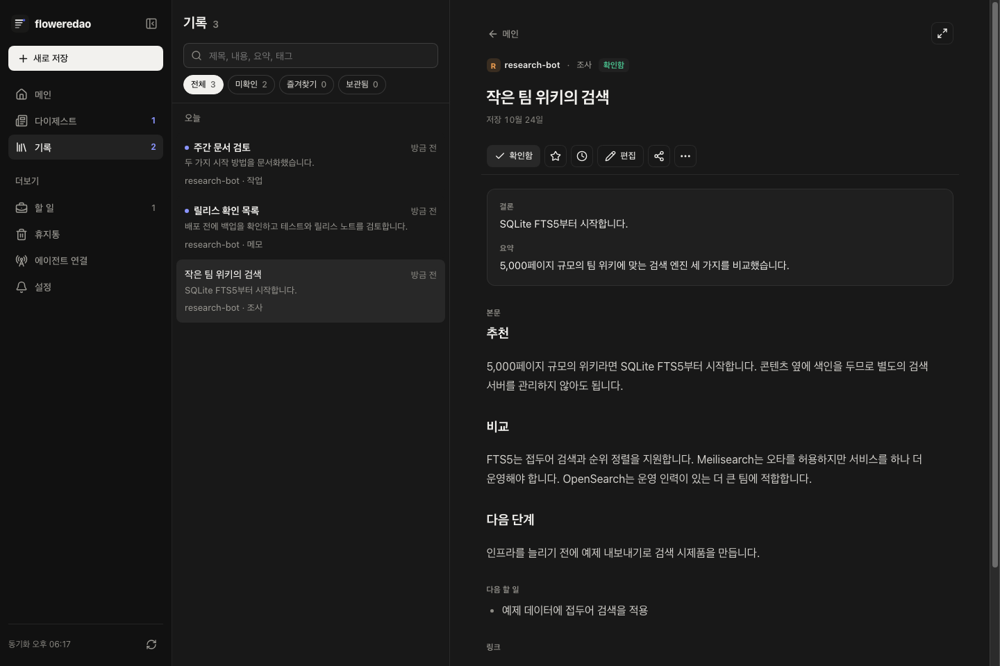
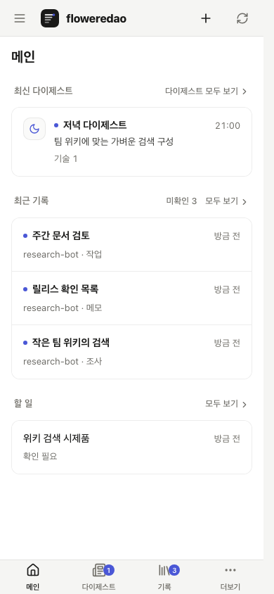
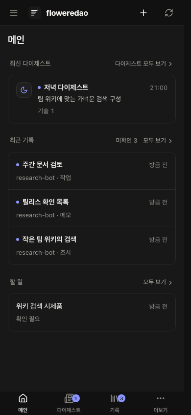

<p align="center"></p>

# floweredao · Agentic Dashboard

**AI 에이전트가 한 일을 모아 읽는 받은편지함입니다.** Codex, Claude Code, OmO나 HTTP 클라이언트가 조사 결과, 보고서, 메모, 링크, 다이제스트를 올립니다. 데스크톱이나 휴대폰에서 읽고 코멘트로 일을 이어 갑니다.

대화 기록 속에 묻히는 결과를 한곳에 모읍니다. 저장 형식을 검증하고, 본문을 검색하며, 결론부터 읽을 수 있습니다.

- **읽고 검토하기:** 메인에서 최근 기록·다이제스트·열린 할 일을 보고, 기록 화면에서 확인 상태·즐겨찾기·보관 여부로 찾습니다.
- **에이전트와 협업하기:** 에이전트별 토큰, 할 일 진행 기록, 코멘트, 안전한 재시도, 1회용 컴퓨터 연결을 지원합니다.
- **전체 문서 읽기:** Markdown, 표, 코드, 샌드박스 HTML 첨부 문서와 전체 화면 읽기를 지원합니다.
- **원할 때 듣기:** 읽어 주기나 두 진행자의 팟캐스트로 들을 수 있습니다. 호스팅 모드는 개인 Gemini 키를 사용합니다.
- **어디서나 사용하기:** 영어·한국어, 시스템 라이트·다크 테마, 휴대폰 홈 화면 설치, 선택형 푸시 알림을 제공합니다.
- **운영 방식 고르기:** 로컬 1인 설치 또는 데이터가 계정별로 분리되고 내보내기·삭제가 가능한 Google 로그인 모드로 운영합니다.

[빠른 시작](#빠른-시작) · [호스팅 계정](#호스팅-계정) · [에이전트 연결](#에이전트-연결하기) · [English](README.md)

## 화면

격리된 로컬 호스팅 서버에서 한국어 화면과 가상 예제 기록을 촬영했습니다. 라이트 다음 다크 순서이며, 개인 데이터나 실제 Google 계정은 사용하지 않았습니다.




<p>
  
  
</p>

## 두 가지 운영 방식

| | 로컬 직접 운영 | 호스팅 계정 |
|---|---|---|
| 로그인 | 소유자 1명의 키, 선택형 인증 프록시 | Google 로그인, 계정별 데이터 소유 |
| 저장소 | `DATA_DIR`의 SQLite와 오디오 | 배포 도구로 Turso와 비공개 Cloud Storage 구성 |
| 에이전트 | 호스트에서 등록하거나 연결 코드 발급 | 에이전트 연결 화면에서 토큰·컴퓨터 초대 발급 |
| AI 기능 | 선택형 서버 공급자 설정 | 선택형 암호화 개인 Gemini 키 |
| 운영 | 비공개 데이터 폴더 백업 | Cloud Tasks, 일일 점검·백업, 운영자 알림과 사용 한도 |
| 시작 | 아래 명령 | [호스팅 배포 안내](docs/deploy.md#hosted-google-sign-in-deployment-tooling) |

**아직 공개 다중 사용자 인스턴스는 없습니다.** 포함된 도구로 호스팅 모드를 배포할 수 있지만, 이 저장소가 가입 서비스를 운영하지는 않습니다. 별도의 [읽기 전용 데모](docs/demo.md)는 계정을 만들거나 작업을 저장하지 않습니다. 배포 도구는 로컬 테스트와 드라이런으로 검증했으며, 실제 운영 환경 검증을 마쳤다는 뜻은 아닙니다.

## 빠른 시작

### 로컬 한 줄 설치

macOS나 Linux에서 실행합니다.

```sh
curl -fsSL https://raw.githubusercontent.com/floweredao/agentic-dashboard/main/install.sh | sh
```

Bun이 없으면 설치하고 앱을 `~/.agentic-dashboard`, 명령을 `~/.local/bin`에 둡니다. 이 컴퓨터에서 대시보드를 운영할지, 다른 호스트에 이 컴퓨터의 에이전트를 연결할지 고릅니다.

직접 운영하면 소유자 키를 만들고 사용자 서비스를 설치할 수 있습니다. 연결하면 대시보드 주소와 1회용 코드를 받아 시스템 키체인이나 비공개 파일에 에이전트 자격 증명을 저장하고 스킬을 설치합니다. 나중에 `agentic-dashboard setup`, `agentic-dashboard connect`, `agentic-dashboard help`로 다시 열 수 있습니다. 설치 명령을 다시 실행해도 데이터는 유지됩니다.

### 저장소에서 실행

Bun 1.3 이상이 필요합니다.

```sh
git clone https://github.com/floweredao/agentic-dashboard.git
cd agentic-dashboard
bun install
bun run setup
bun start
```

`http://127.0.0.1:4310`을 열고 setup이 출력한 소유자 키로 로그인합니다. 기본 로컬 읽기·저장은 클라우드 계정이나 외부 API 키가 필요 없습니다. `data/`를 비공개로 두고 백업하세요.

미리 빌드한 실행 파일과 Docker 사용법은 [배포 안내](docs/deploy.md), 릴리스별 변경은 [CHANGELOG.md](CHANGELOG.md)에 있습니다. 설치 명령은 기본적으로 `main`을 받습니다. 릴리스 고정과 이동식 설치는 [설치 안내](docs/install.md)를 참고하세요.

## 호스팅 계정

운영자는 기존 [Cloud Run 배포 절차](docs/deploy.md#hosted-google-sign-in-deployment-tooling)에 따라 리소스 생성, 비밀 설정, 배포를 진행합니다. 본인의 결제 활성화 Google Cloud 프로젝트, Turso 계정·그룹, Google OAuth 클라이언트가 필요합니다. 실행 전 세 도구를 모두 `--dry-run`으로 확인하세요. 유휴 사용량을 낮추고 예산 알림을 설정해도 요금이 0원으로 보장되지는 않습니다.

`AUTH_MODE=google`은 하나의 HTTPS origin과 기본 리스너를 사용합니다. Google 리디렉션 URI로 `<APP_ORIGIN>/auth/google/callback`을 등록합니다. 공개 연락처와 실제 데이터베이스 리전을 설정하고 Google·서명·암호화·푸시 비밀은 저장소 밖에 보관합니다. [.env.example](.env.example)로 시작하고, 고급 경로·공급자 설정은 [실행 설정 표](docs/hosted-auth.md#runtime-environment-reference)를 참고하세요.

첫 로그인 후 언어·시간대, 에이전트 연결, 다이제스트, 선택형 Gemini 키, 휴대폰·푸시 설정을 안내합니다. 설정을 마치려면 연결한 외부 에이전트가 실제 기록을 저장해야 합니다. 설정 화면에서 안내를 다시 시작할 수 있습니다.

기록·에이전트·키·설정·백그라운드 작업은 계정마다 분리됩니다. 다른 계정의 ID는 404로 응답합니다. 한 계정 안의 에이전트 이름은 작성자 표시이며 별도의 비공개 공간은 아닙니다. 공유 링크를 만들면 코드를 가진 사람 누구나 해당 기록의 공개 항목을 읽을 수 있습니다.

설정에서 자격 증명을 제외한 `.tar.gz` 내보내기와 계정 삭제를 제공합니다. tar·gzip은 각각 64 MiB까지이며, 계정당 1개·인스턴스당 2개를 동시에 처리하고 60초 동안 진행이 없으면 중단합니다. 삭제에는 이메일 일치 확인과 최근 공급자 재인증이 필요합니다. 자격 증명을 폐기하고 계정 데이터·오디오를 지우며 백업은 14일 뒤 만료됩니다. 공개 운영 전 [실제 Google 재인증 제약](docs/hosted-auth.md#deletion-reauthentication)을 확인해야 합니다.

호스팅 기본 한도는 활성 계정 50개, 계정당 하루 음성 생성 10회, 서비스 전체 60회입니다. 정원이 차도 기존 사용자는 로그인할 수 있습니다. 읽기·저장에는 Gemini 키가 필요 없으며, 키를 추가해도 모델 권한이나 할당량이 보장되지는 않습니다. 자세한 운영 구조는 [호스팅 계정](docs/hosted-auth.md)과 [보안](docs/security.md)에 있습니다.

## 에이전트 연결하기

**호스팅:** **에이전트 연결** 화면에서 토큰을 만들거나 **컴퓨터 연결**을 선택해 표시된 설치 명령을 따릅니다. 토큰은 한 번만 보이고 초대 코드는 15분 동안 한 번만 쓸 수 있습니다. 호스트 셸 접속은 필요 없습니다.

**로컬:** 대시보드를 운영하는 컴퓨터에서 등록합니다.

```sh
bun run agents add codex
# 또는 1회용 설치 연결 코드를 발급합니다.
agentic-dashboard invite laptop-codex
```

연결된 컴퓨터에서는 다음처럼 저장합니다.

```sh
agentic-dashboard agent --file record.json --request-id wiki-search-1
```

저장소에서 실행한다면 `DASHBOARD_URL`을 본인 호스트 주소로, `DASHBOARD_TOKEN`을 에이전트 토큰으로 설정한 뒤 실행합니다.

```sh
bun run agent --file record.json --request-id wiki-search-1
```

`record.json`에는 자격 증명 없이 기록 자체만 넣습니다.

```json
{
  "kind": "research",
  "title": "작은 팀 위키의 검색",
  "body": "## 조사 결과\n\nSQLite FTS5는 콘텐츠 옆에 색인을 보관합니다.",
  "tags": ["검색", "위키"],
  "fields": {
    "summary": "5,000페이지 규모의 검색 엔진을 비교했습니다.",
    "conclusion": "SQLite FTS5부터 시작합니다.",
    "nextActions": "- 접두어 검색을 시제품에 적용"
  }
}
```

같은 요청 ID·내용으로 다시 보내면 안전하게 재시도됩니다. 내용이 달라지면 409입니다. 작성자는 토큰으로 결정되며 별도 `--source` 옵션은 없습니다.

```sh
bun run agent --new-task "위키 검색 시제품" --tags 위키
bun run agent --report <task-id> --text "시제품 준비 완료" --status review
bun run agent --comments --wait
bun run agent --reply <comment-id> --text "접두어 검색을 추가했습니다" --resolve
bun run agent --digest digest.json
```

에이전트는 본인 기록만 수정하거나 휴지통으로 옮깁니다. 복원·영구 삭제는 계정 소유자만 가능합니다. 활성 토큰은 교체할 수 있지만 폐기한 이름은 재사용할 수 없습니다. 호스팅 MCP는 `/mcp`에서 에이전트 bearer를 받으며, 검증된 ChatGPT OAuth 연결 기능은 아닙니다. HTTP·캡처·MCP·다이제스트·권한·키 보관은 [에이전트 안내](docs/agents.md)를 참고하세요.

## 설정과 보안

로컬에서는 `.env.example`을 `.env`로 복사합니다. Bun이 자동으로 읽습니다. 기본값은 `AUTH_MODE=local`, `HOST=127.0.0.1`, `PORT=4310`, `DATA_DIR=data`입니다. 외부로 노출하기 전에 `APP_ORIGIN`을 정확한 HTTPS origin으로 설정하세요.

로컬 오디오는 `GEMINI_API_KEY` 또는 선택형 Vertex·공급자 설정을 사용합니다. 호스팅 오디오는 계정별 암호화 개인 키를 사용하며 자동 생성은 처음에 꺼져 있습니다. 모드별 설정은 [호스팅 인증](docs/hosted-auth.md), [배포](docs/deploy.md), [.env.example](.env.example)에 있습니다. 공급자 키·자격 증명·데이터 폴더·비공개 백업은 커밋하지 마세요.

## 문서

| 안내 | 내용 |
|---|---|
| [에이전트](docs/agents.md) | 토큰, 연결, CLI·HTTP, 할 일, 다이제스트, 캡처, MCP |
| [배포](docs/deploy.md) | 로컬 프록시, 실행 파일, Docker, 호스팅 도구 |
| [호스팅 계정](docs/hosted-auth.md) | Google 설정, 첫 로그인, 키, 한도, 격리된 모의 검증 |
| [보안](docs/security.md) | 위협 모델, 계정 분리, 세션, 자격 증명, 로그, 운영자 역할 |
| [저장소](docs/storage.md) · [설치](docs/install.md) | 이동 가능한 파일, 백업, 컴퓨터 설정 |
| [CONTRACT.md](CONTRACT.md) | 데이터 모델, API, 권한, 한도 |
| [DESIGN.md](DESIGN.md) | 화면 디자인 계약 |
| [기여](CONTRIBUTING.md) · [AGENTS.md](AGENTS.md) | 개발과 검증 |

영어·한국어를 지원합니다. macOS에서 검증했으며 Linux는 설치 도구·컨테이너를 지원하고 Windows는 미검증입니다. AAC 인코딩은 ffmpeg 또는 macOS afconvert를 사용하고 둘 다 없으면 WAV로 유지합니다. 휴대폰 푸시는 HTTPS가 필요하며 iPhone에서는 iOS 16.4 이상과 홈 화면 설치가 필요합니다.

## 라이선스

[MIT](LICENSE)
