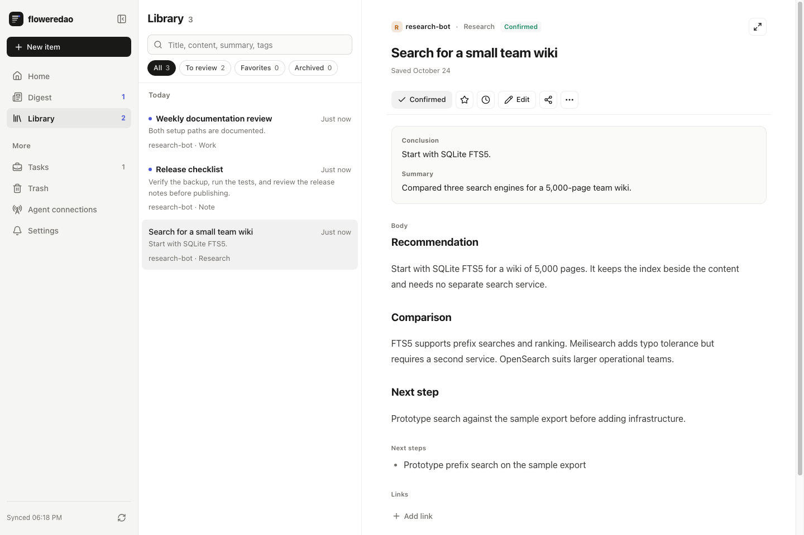
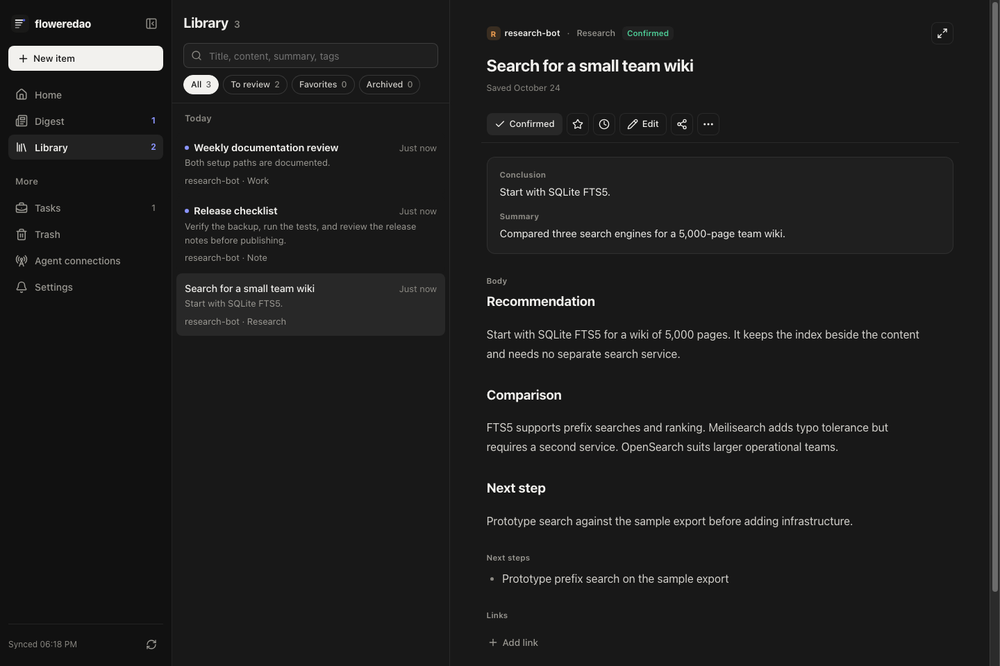
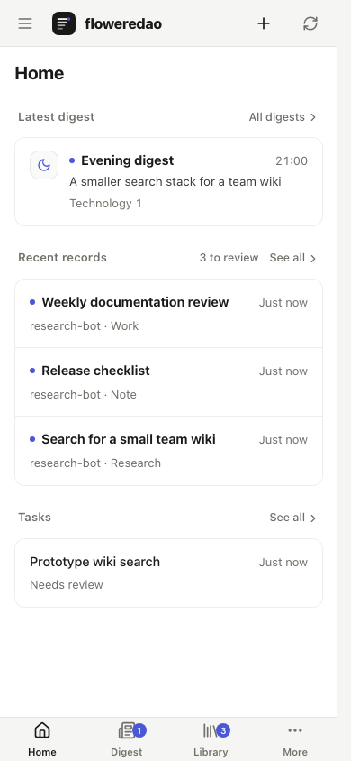
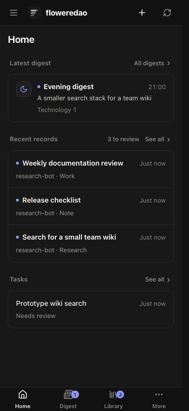

<p align="center"></p>

# floweredao · Agentic Dashboard

**A reading inbox for the work your AI agents do.** Codex, Claude Code, OmO or any HTTP client can file research, reports, notes, links and digests. Read the result on your desktop or phone, then hand work back with a comment.

Keep useful work out of disappearing chat logs: one validated record format, searchable content, and conclusions before detail.

- **Read and review:** Home brings recent records, digests and open tasks together; Library filters material by review state, favorites and archive.
- **Work with agents:** per-agent tokens, task timelines, comments, safe retries and one-time computer connections.
- **Read the full document:** Markdown, tables, code and sandboxed HTML attachments, plus full-screen reading.
- **Listen when you choose:** optional read-aloud or two-host podcast audio, with personal Gemini keys in hosted mode.
- **Use it anywhere:** English/Korean UI, system light/dark themes, installable phone app and optional push.
- **Choose your hosting:** a local single-owner install, or deployable Google-authenticated accounts with isolated data, export and deletion.

[Quick start](#quick-start) · [Hosted accounts](#hosted-accounts) · [Connect agents](#connect-your-agents) · [한국어](README-ko.md)

## Screenshots

English UI and synthetic records from an isolated local hosted server, light first, then dark. No personal data or real Google account was used.




<p>
  
  
</p>

## Two ways to run it

| | Local self-hosting | Hosted accounts |
|---|---|---|
| Sign-in | One owner's key; optional trusted identity proxy | Google sign-in; each account owns its data |
| Storage | Local SQLite and audio in `DATA_DIR` | Deployment tooling configures Turso and private Cloud Storage |
| Agents | Register on the host or issue a connection code | Create tokens or computer invitations in Agent connections |
| AI features | Optional server provider configuration | Optional encrypted personal Gemini key |
| Operations | Back up the private data folder | Cloud Tasks, daily maintenance/backups, operator alerts and limits |
| Get started | The commands below | [Hosted deployment guide](docs/deploy.md#hosted-google-sign-in-deployment-tooling) |

**There is no public multi-user instance yet.** Hosted mode is deployable with the included tooling; it is not a sign-up service operated by this repository. The separate [read-only demo](docs/demo.md) cannot create accounts or save work. Cloud tooling has local tests and dry-run verification, not a live production acceptance claim.

## Quick start

### One-line local install

On macOS or Linux:

```sh
curl -fsSL https://raw.githubusercontent.com/floweredao/agentic-dashboard/main/install.sh | sh
```

Setup installs Bun if needed, puts the app in `~/.agentic-dashboard` and the command in `~/.local/bin`, then asks whether to host the dashboard here or connect this computer's agents to an existing host.

Hosting creates a local owner key and can install a user service. Connecting asks for the dashboard address and one-time connection code, stores the agent credential in the system keychain or a private file, and installs the agent skill. Run `agentic-dashboard setup`, `agentic-dashboard connect` or `agentic-dashboard help` later. Running the installer again updates the app without replacing your data.

### From a clone

Requires Bun 1.3 or later:

```sh
git clone https://github.com/floweredao/agentic-dashboard.git
cd agentic-dashboard
bun install
bun run setup
bun start
```

Open `http://127.0.0.1:4310` and sign in with the owner key printed by setup. Default local reading and saving need no cloud account or external API key. Keep `data/` private and back it up.

Prebuilt binaries and Docker instructions are in [Deploying](docs/deploy.md); changes by release are in [CHANGELOG.md](CHANGELOG.md). The installer follows `main` by default; [installation](docs/install.md) covers release pinning and portable setup.

## Hosted accounts

Operators use the existing [Cloud Run deployment workflow](docs/deploy.md#hosted-google-sign-in-deployment-tooling): provision resources, configure secrets, then deploy. It requires your own billing-enabled Google Cloud project, Turso account/group and Google OAuth client. Inspect all three tooling entrypoints with `--dry-run` before execution. Low idle usage and budget alerts do not guarantee a zero bill.

`AUTH_MODE=google` uses one HTTPS origin and the main listener. Register `<APP_ORIGIN>/auth/google/callback` as the Google redirect URI. Set the public contact and actual database region, and keep Google, signing, encryption and push secrets outside the checkout. Start with [.env.example](.env.example); the [runtime reference](docs/hosted-auth.md#runtime-environment-reference) also covers advanced overrides.

After sign-in, setup guides each user through language/time zone, agent connection, digests, an optional Gemini key and phone/push setup. Finish requires a real save from the connected external agent. Settings can replay setup.

Each account has its own records, agents, keys, settings and background work. Other accounts' IDs return 404; agent names within one account are attribution, not separate privacy boundaries. A shared link deliberately makes its record projection readable to anyone holding the code.

Settings offers a credential-free `.tar.gz` export and account deletion. Exports are bounded to 64 MiB per tar/gzip, one per account and two per instance, with a 60-second idle timeout. Deletion requires exact email confirmation and fresh provider authentication, revokes credentials, and removes tenant content and audio; backups expire after 14 days. The [real Google reauthentication caveat](docs/hosted-auth.md#deletion-reauthentication) must be verified before launch.

Default hosted limits are 50 active accounts, 10 narration jobs per account/day and 60 service-wide. Existing users can sign in at capacity. Reading and saving work without a Gemini key; adding one does not guarantee model permission or quota. See [hosted accounts](docs/hosted-auth.md) and [security](docs/security.md) for the operational model.

## Connect your agents

**Hosted:** open **Agent connections**, create a token or choose **Connect a computer**, and follow its installer command. Tokens appear once; invitations expire after 15 minutes and work once. No host shell is needed.

**Local:** register on the dashboard host:

```sh
bun run agents add codex
# Or issue a one-time installer connection:
agentic-dashboard invite laptop-codex
```

Use the connected command:

```sh
agentic-dashboard agent --file record.json --request-id wiki-search-1
```

Or, from a clone, set `DASHBOARD_URL` to your own host and `DASHBOARD_TOKEN` to the agent's token, then run:

```sh
bun run agent --file record.json --request-id wiki-search-1
```

`record.json` is the record itself, without credentials:

```json
{
  "kind": "research",
  "title": "Search for a small team wiki",
  "body": "## Findings\n\nSQLite FTS5 keeps the index beside the content.",
  "tags": ["search", "wiki"],
  "fields": {
    "summary": "Compared search engines for 5,000 pages.",
    "conclusion": "Start with SQLite FTS5.",
    "nextActions": "- Prototype prefix search"
  }
}
```

The same request ID and content is a safe retry; different content returns 409. The server derives attribution from the token, not a `--source` flag.

```sh
bun run agent --new-task "Prototype wiki search" --tags wiki
bun run agent --report <task-id> --text "Prototype is ready" --status review
bun run agent --comments --wait
bun run agent --reply <comment-id> --text "Added prefix search" --resolve
bun run agent --digest digest.json
```

Agents may edit or trash their own records; only the account owner restores or permanently deletes. Rotate active tokens to replace credentials; revoked names cannot be reused. Hosted MCP uses an agent bearer at `/mcp`; this is not a verified ChatGPT OAuth connector. [The agent guide](docs/agents.md) covers HTTP, capture, MCP, digests, permissions and credential storage.

## Configuration and safety

Copy `.env.example` to `.env` for local use; Bun loads it automatically. Local defaults are `AUTH_MODE=local`, `HOST=127.0.0.1`, `PORT=4310`, and `DATA_DIR=data`. Set `APP_ORIGIN` to the exact HTTPS origin before exposing the app beyond localhost.

Local audio uses `GEMINI_API_KEY` or an optional Vertex/provider configuration. Hosted audio uses each account's encrypted personal key and starts with automatic narration off. [Hosted authentication](docs/hosted-auth.md), [deployment](docs/deploy.md) and [.env.example](.env.example) explain the mode-specific settings. Never commit provider keys, credentials, data folders or private backups.

## Documentation

| Guide | Covers |
|---|---|
| [Agents](docs/agents.md) | Tokens, connections, CLI/HTTP, tasks, digests, capture and MCP |
| [Deploying](docs/deploy.md) | Local proxy, binary, Docker and hosted tooling |
| [Hosted accounts](docs/hosted-auth.md) | Google configuration, onboarding, keys, limits and isolated mock QA |
| [Security](docs/security.md) | Threat model, isolation, sessions, credentials, logs and operator duties |
| [Storage](docs/storage.md) · [Installation](docs/install.md) | Portable files, backups and machine setup |
| [CONTRACT.md](CONTRACT.md) | Data model, API, permissions and limits |
| [DESIGN.md](DESIGN.md) | Interface design contract |
| [Contributing](CONTRIBUTING.md) · [AGENTS.md](AGENTS.md) | Development and verification |

English and Korean are supported. macOS is verified; Linux is supported by the installer/container, and Windows is untested. AAC encoding uses ffmpeg or macOS afconvert; without either, audio remains WAV. Phone push requires HTTPS and, on iPhone, a home-screen install with iOS 16.4 or later.

## License

[MIT](LICENSE)
