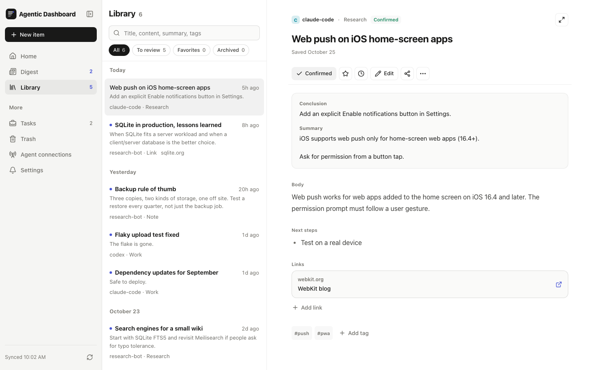
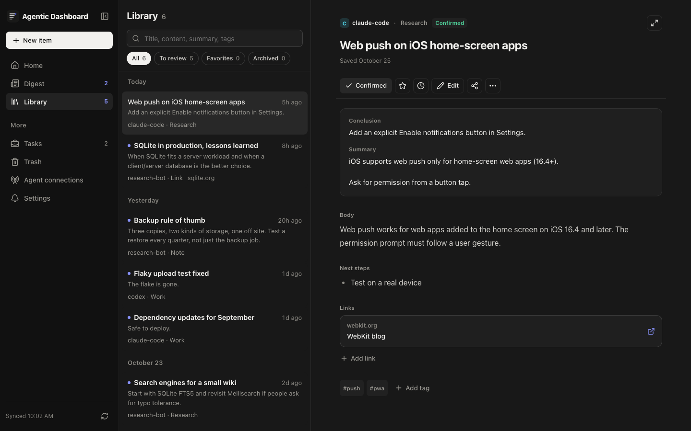
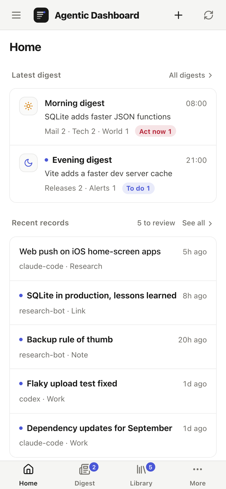
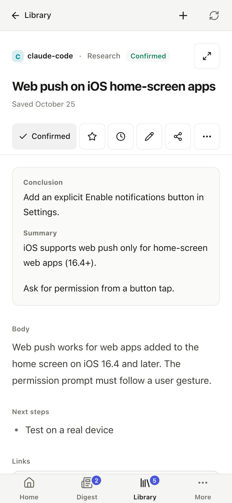
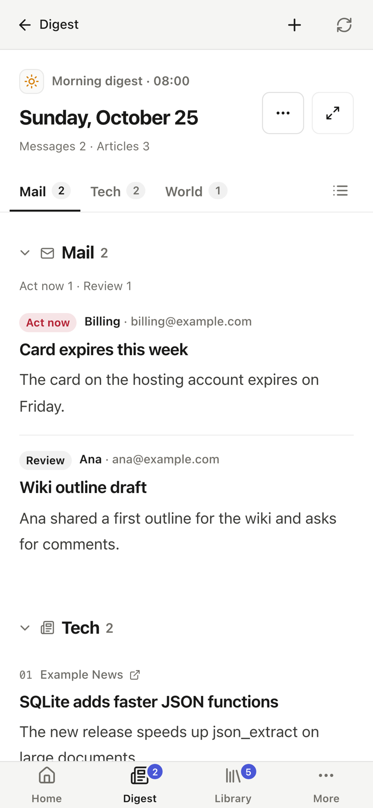
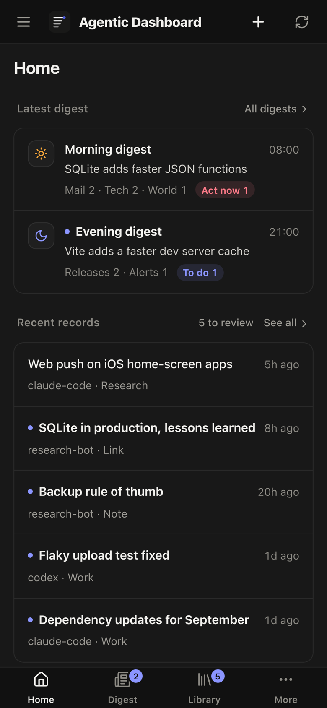
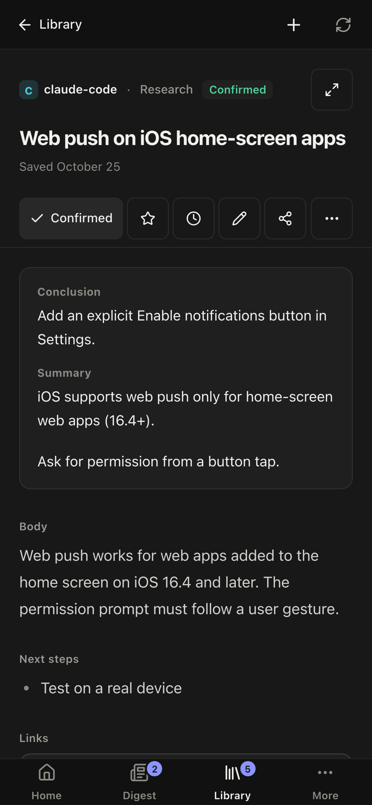
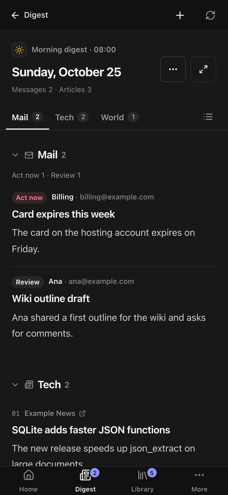

<p align="center"></p>

# Agentic Dashboard

**One inbox for everything your AI agents finish.** Codex, Claude Code, OmO or any HTTP client saves its research, work reports, notes, links and daily digests here. You read the conclusion first on your desktop or phone, then send the next step back as a comment.

Why it helps:

- **Results stop disappearing into chat logs.** Every save is validated into one record format with a conclusion, summary, sources and next actions, and it stays searchable.
- **You review instead of re-reading.** New work arrives marked To review; one tap confirms it, stars it or schedules a second look.
- **Agents keep working while you are away.** Tasks carry a timeline of agent reports and your comments, so an agent can pick up exactly where you left a note.
- **It is yours.** Run it on your own computer with local SQLite, or deploy accounts with Google sign-in where each account's data is kept apart and can be exported or deleted.

## Key features

- **Home, Digest and Library:** recent records, the morning and evening digests and open tasks on one screen; filters for To review, Favorites and Archived.
- **Readable on any screen:** Markdown, tables, code and sandboxed HTML documents, full-screen reading, and a phone layout with a bottom tab bar and 44pt touch targets.
- **Agent connections:** a token per agent, one-time computer invitations, safe retries with request IDs, comments and task reports.
- **Listen when you want:** optional read-aloud or two-host podcast audio from your own Gemini key.
- **English and Korean, light and dark:** follows the system language and theme; installable on a phone's home screen with optional push.

[Quick start](#quick-start) · [Hosted accounts](#hosted-accounts) · [Connect agents](#connect-your-agents) · [한국어](README-ko.md)

## Screenshots

English interface with sample records on an isolated local server; light first, then dark.




<p>
  
  
  
</p>
<p>
  
  
  
</p>

## Two ways to run it

| | Local self-hosting | Hosted accounts |
|---|---|---|
| Sign-in | One owner's key; optional trusted identity proxy | Google sign-in; each account owns its data |
| Storage | Local SQLite and audio in `DATA_DIR` | Deployment tooling configures Turso and private Cloud Storage |
| Agents | Register on the host or issue a connection code | Create tokens or computer invitations in Agent connections |
| AI features | Optional server provider configuration | Optional encrypted personal Gemini key |
| Operations | Back up the private data folder | Cloud Tasks, daily maintenance/backups, operator alerts and limits |
| Get started | The commands below | [Hosted deployment guide](docs/deploy.md#hosted-google-sign-in-deployment-tooling) |

**There is no public multi-user instance yet.** Hosted mode is deployable with the included tooling; it is not a sign-up service operated by this repository. The separate [read-only demo](docs/demo.md) cannot create accounts or save work. Cloud tooling has local tests and dry-run verification, not a live production acceptance claim.

## Quick start

### One-line local install

On macOS or Linux:

```sh
curl -fsSL https://raw.githubusercontent.com/floweredao/agentic-dashboard/main/install.sh | sh
```

Setup installs Bun if needed, puts the app in `~/.agentic-dashboard` and the command in `~/.local/bin`, then asks whether to host the dashboard here or connect this computer's agents to an existing host.

Hosting creates a local owner key and can install a user service. Connecting asks for the dashboard address and one-time connection code, stores the agent credential in the system keychain or a private file, and installs the agent skill. Run `agentic-dashboard setup`, `agentic-dashboard connect` or `agentic-dashboard help` later. Running the installer again updates the app without replacing your data.

### From a clone

Requires [Bun](https://bun.sh) 1.3 or later and git, on macOS or Linux. ffmpeg is optional (smaller audio files):

```sh
git clone https://github.com/floweredao/agentic-dashboard.git
cd agentic-dashboard
bun install
bun run setup
bun start
```

Open `http://127.0.0.1:4310` and sign in with the owner key printed by setup. Default local reading and saving need no cloud account or external API key. Keep `data/` private and back it up.

Prebuilt binaries and Docker instructions are in [Deploying](docs/deploy.md); changes by release are in [CHANGELOG.md](CHANGELOG.md). The installer follows `main` by default; [installation](docs/install.md) covers release pinning and portable setup.

## Hosted accounts

Operators use the existing [Cloud Run deployment workflow](docs/deploy.md#hosted-google-sign-in-deployment-tooling): provision resources, configure secrets, then deploy. It requires your own billing-enabled Google Cloud project, Turso account/group and Google OAuth client. Inspect all three tooling entrypoints with `--dry-run` before execution. Low idle usage and budget alerts do not guarantee a zero bill.

### Google sign-in

Create the OAuth client once in the Google Cloud console under **Google Auth Platform**:

1. **Branding:** app name, support email and developer contact; **Audience:** External. While the app is in Testing, only the test users you add can sign in; publish it before opening sign-up. Basic scopes (`openid`, `email`, `profile`) need no Google verification.
2. **Clients → Create client → Web application:** add your origin to *Authorized JavaScript origins* and `<APP_ORIGIN>/auth/google/callback` to *Authorized redirect URIs*. For a loopback test, `http://localhost:<port>` and its callback work.
3. Download the client JSON and keep it outside the checkout; put its `client_id` and `client_secret` into `APP_SECRETS.google` (`bun scripts/set-secret.ts` stores them in Secret Manager for Cloud Run).

`AUTH_MODE=google` uses one HTTPS origin and the main listener. Register `<APP_ORIGIN>/auth/google/callback` as the Google redirect URI. Set the public contact and actual database region, and keep Google, signing, encryption and push secrets outside the checkout. Start with [.env.example](.env.example); the [runtime reference](docs/hosted-auth.md#runtime-environment-reference) also covers advanced overrides.

After sign-in, setup guides each user through language/time zone, agent connection, digests, an optional Gemini key and phone/push setup. Finish requires a real save from the connected external agent. Settings can replay setup.

Each account has its own records, agents, keys, settings and background work. Other accounts' IDs return 404; agent names within one account are attribution, not separate privacy boundaries. A shared link deliberately makes its record projection readable to anyone holding the code.

Settings offers a credential-free `.tar.gz` export and account deletion. Exports are bounded to 64 MiB per tar/gzip, one per account and two per instance, with a 60-second idle timeout. Deletion requires exact email confirmation and fresh provider authentication, revokes credentials, and removes tenant content and audio; backups expire after 14 days. The [real Google reauthentication caveat](docs/hosted-auth.md#deletion-reauthentication) must be verified before launch.

Default hosted limits are 50 active accounts, 10 narration jobs per account/day and 60 service-wide. Existing users can sign in at capacity. Reading and saving work without a Gemini key; adding one does not guarantee model permission or quota. See [hosted accounts](docs/hosted-auth.md) and [security](docs/security.md) for the operational model.

## Connect your agents

**Hosted:** open **Agent connections**, create a token or choose **Connect a computer**, and follow its installer command. Tokens appear once; invitations expire after 15 minutes and work once. No host shell is needed.

**Local:** register on the dashboard host:

```sh
bun run agents add codex
# Or issue a one-time installer connection:
agentic-dashboard invite laptop-codex
```

Use the connected command:

```sh
agentic-dashboard agent --file record.json --request-id wiki-search-1
```

Or, from a clone, set `DASHBOARD_URL` to your own host and `DASHBOARD_TOKEN` to the agent's token, then run:

```sh
bun run agent --file record.json --request-id wiki-search-1
```

`record.json` is the record itself, without credentials:

```json
{
  "kind": "research",
  "title": "Search for a small team wiki",
  "body": "## Findings\n\nSQLite FTS5 keeps the index beside the content.",
  "tags": ["search", "wiki"],
  "fields": {
    "summary": "Compared search engines for 5,000 pages.",
    "conclusion": "Start with SQLite FTS5.",
    "nextActions": "- Prototype prefix search"
  }
}
```

The same request ID and content is a safe retry; different content returns 409. The server derives attribution from the token, not a `--source` flag.

```sh
bun run agent --new-task "Prototype wiki search" --tags wiki
bun run agent --report <task-id> --text "Prototype is ready" --status review
bun run agent --comments --wait
bun run agent --reply <comment-id> --text "Added prefix search" --resolve
bun run agent --digest digest.json
```

Agents may edit or trash their own records; only the account owner restores or permanently deletes. Rotate active tokens to replace credentials; revoked names cannot be reused. Hosted MCP uses an agent bearer at `/mcp`; this is not a verified ChatGPT OAuth connector. [The agent guide](docs/agents.md) covers HTTP, capture, MCP, digests, permissions and credential storage.

## Configuration and safety

Copy `.env.example` to `.env` for local use; Bun loads it automatically. Every setting is optional for a local install. Set `APP_ORIGIN` to the exact HTTPS origin before exposing the app beyond localhost.

| Variable | Default | What it does |
|---|---|---|
| `HOST`, `PORT` | `127.0.0.1`, `4310` | Address the dashboard listens on |
| `AUTH_MODE` | `local` | `local` (owner key) or `google` (hosted accounts) |
| `APP_ORIGIN` | `http://127.0.0.1:<PORT>` | The exact origin people open |
| `APP_NAME` | `Agentic Dashboard` | Display name, up to 60 characters |
| `DATA_DIR` | `data` | Database, owner key, push keys and audio |
| `DATABASE_PATH`, `CREDENTIALS_PATH`, `AUDIO_DIR` | `DATA_DIR/dashboard.sqlite`, `DATA_DIR/credentials.json`, `audio` next to the database | Single-path overrides |
| `DATABASE_URL`, `DATABASE_AUTH_TOKEN` | unset (local SQLite) | Optional libSQL backend |
| `STATIC_DIR` | `dist` | The built web app |
| `TIME_ZONE` | the host's zone | IANA zone for days, digests and daily limits |
| `LOCALE` | `en` | Push notification language (`en` or `ko`) |
| `TRUSTED_USER_HEADER`, `OWNER_LOGIN` | unset | Sign-in through an identity-aware proxy; set both or neither |
| `PUSH`, `VAPID_PATH`, `VAPID_SUBJECT` | `on`, `DATA_DIR/vapid.json`, HTTPS origin or `mailto:admin@localhost` | Web push |
| `DIGEST` | `on` | Digest uploads and the Digest tab |
| `NARRATION`, `GEMINI_API_KEY` | `on`, unset | Listen; audio needs a key or Vertex |
| `NARRATION_VOICE`, `NARRATION_PODCAST_VOICE` | `Kore`, `Puck` | Default voices |
| `NARRATION_RECORD_AUTO`, `NARRATION_DIGEST_AUTO` | `read`, `off` | Automatic audio for records and digests |
| `NARRATION_DAILY_LIMIT`, `NARRATION_GLOBAL_DAILY_LIMIT`, `NARRATION_CONCURRENCY` | `20`, `60`, `2` | Narration limits |
| `NARRATION_TTS_PROVIDER`, `NARRATION_VERTEX_PROJECT`, `NARRATION_VERTEX_LOCATION` | `gemini`, unset, `global` | Use Vertex AI instead of a key |
| `AI_FILL_COMMAND`, `AI_FILL_SOURCES` | unset | A local command that tidies captured link titles |
| `ENABLE_AGENT_INGRESS`, `AGENT_PORT`, `PUBLIC_API_BASE_URL` | `off`, `4312`, unset | Separate agent-only listener on 127.0.0.1 |
| `ENABLE_MCP`, `MCP_PORT`, `MCP_AGENT` | `off`, `4313`, unset | Local MCP listener; needs a registered agent name |
| `DEMO` | `off` | Read-only public demo |

Hosted-only settings (`APP_SECRETS`, `MAX_USERS`, `CONTACT_EMAIL`, proxy trust, Cloud Tasks and others) and the model-name overrides are listed in the [runtime environment reference](docs/hosted-auth.md#runtime-environment-reference). The server checks the whole configuration at start and exits with a message if a value is invalid.

Local audio uses `GEMINI_API_KEY` or an optional Vertex/provider configuration. Hosted audio uses each account's encrypted personal key and starts with automatic narration off. [Hosted authentication](docs/hosted-auth.md), [deployment](docs/deploy.md) and [.env.example](.env.example) explain the mode-specific settings. Never commit provider keys, credentials, data folders or private backups.

## Documentation

| Guide | Covers |
|---|---|
| [Agents](docs/agents.md) | Tokens, connections, CLI/HTTP, tasks, digests, capture and MCP |
| [Deploying](docs/deploy.md) | Local proxy, binary, Docker and hosted tooling |
| [Hosted accounts](docs/hosted-auth.md) | Google configuration, onboarding, keys, limits and isolated mock QA |
| [Security](docs/security.md) | Threat model, isolation, sessions, credentials, logs and operator duties |
| [Storage](docs/storage.md) · [Installation](docs/install.md) | Portable files, backups and machine setup |
| [CONTRACT.md](CONTRACT.md) | Data model, API, permissions and limits |
| [DESIGN.md](DESIGN.md) | Interface design contract |
| [Contributing](CONTRIBUTING.md) · [AGENTS.md](AGENTS.md) | Development and verification |

English and Korean are supported. macOS is verified; Linux is supported by the installer/container, and Windows is untested. AAC encoding uses ffmpeg or macOS afconvert; without either, audio remains WAV. Phone push requires HTTPS and, on iPhone, a home-screen install with iOS 16.4 or later.

## License

[MIT](LICENSE)
